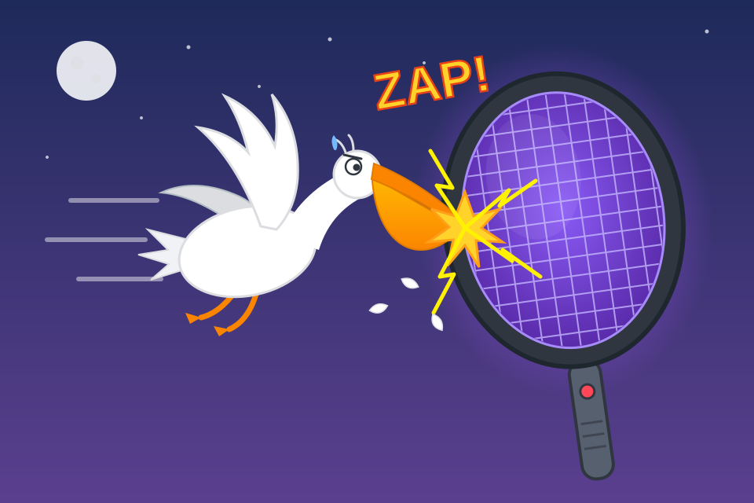
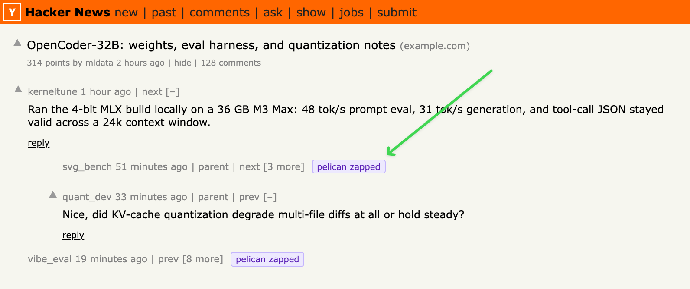

# Pelican Zapper

Every LLM release thread on Hacker News eventually sprouts thirty subthreads
debating SVGs of pelicans riding bicycles. Pelican Zapper is a tiny browser
extension that automatically collapses HN comments mentioning `pelican` or
`pelicans` and leaves the rest of the discussion alone.



<sub>"Generate an SVG of a pelican flying into an oversized mosquito zapper" via Qwen 4 Max with thinking: high.</sub>

The extension is a static content script on `https://news.ycombinator.com/*`
(`extension/content.js`, ~95 lines, no dependencies) that needs no permissions
and runs no background scripts. Collapsing stays local even when you are logged
in. It never flags, downvotes, or reports comments, and it makes no network
requests to YC's servers or changes to your HN account. The same `extension/`
folder works across Chrome/Chromium, Firefox, and Safari on macOS and iOS, with
no build step needed to load it unpacked.

## What it looks like

Matching comments collapse through HN's own `[n more]` control and get a small
`pelican zapped` tag in the comment header:



Click `[n more]` to read a zapped comment anyway. The badge disappears, and
Pelican Zapper leaves that comment alone until you reload the page.

## Install

### Chrome, Brave, Arc, Edge (Chromium)

1. Clone or download this repository.
2. Open `chrome://extensions` and turn on Developer mode.
3. Click Load unpacked and select the `extension/` directory.

### Firefox

Pelican Zapper requires Firefox 142+ for Manifest V3 and Firefox's built-in
no-data-collection declaration.

For a persistent install, download the signed `.xpi` from
[GitHub Releases](https://github.com/lexh/pelican-zapper/releases) and open it
in Firefox. To load temporarily from source, open
`about:debugging#/runtime/this-firefox`, click Load Temporary Add-on, and select
`extension/manifest.json`.

### Safari (macOS and iOS)

For a temporary load on macOS, enable Settings > Advanced > Show features for
web developers, then choose Settings > Developer > Add Temporary Extension and
select `extension/`.

Building the native macOS and iOS app targets requires full Xcode:

```sh
./scripts/package-safari.sh com.yourname.PelicanZapper
open 'build/safari/Pelican Zapper/Pelican Zapper.xcodeproj'
```

Select Pelican Zapper (macOS) or Pelican Zapper (iOS) in Xcode, configure
signing with your team (or build unsigned locally on macOS with Settings >
Developer > Allow unsigned extensions), run the containing app once, and enable
Pelican Zapper for `news.ycombinator.com` in Safari Extensions settings.

## How it works

At `document_idle`, Pelican Zapper walks `tr.athing.comtr` comment rows from
bottom to top so matching replies collapse before a matching parent collapses
over them. Expanding the parent later keeps nested matches collapsed. The
script marks each matching row as checked so re-runs skip it, and leaves
comments that you or HN already collapsed alone without adding a badge.

For each row, it tests `/\bpelicans?\b/i` against only that comment's own
`.commtext` body, inserting line breaks at `<p>`, `<br>`, `<pre>`, and
`<blockquote>` boundaries so adjacent blocks do not join words together. Words
like `pelicanry` do not match, and the check ignores usernames, story titles,
navigation links, link `href` destinations, `title` attributes, and descendant
replies.

HN's client script sends a `collapse?id=...` request whenever `#logout` is in
the DOM. To keep auto-collapses out of your account, Pelican Zapper temporarily
removes only the `id="logout"` attribute during its synchronous native click
and restores it in `finally`.

Because HN's delegated click handler calls `stopImmediatePropagation()`, each
zapped row uses a `MutationObserver` on its own `class` attribute, with no
document-wide observer or polling. When you expand the comment and HN removes
`coll`, the observer removes the badge and disconnects.

## Development and packaging

You only need Node.js 22+ for running tests (`jsdom` is the sole dev
dependency):

```sh
npm ci
npm run check
npm test
npx --yes web-ext@9 lint --source-dir extension
npm run package:webext
```

`npm run package:webext` builds store-ready archives at
`build/pelican-zapper-firefox.zip` and `build/pelican-zapper-chrome.zip`.

## License

[MIT](LICENSE)
